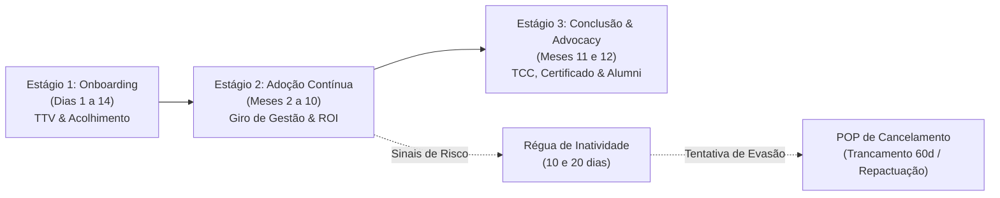
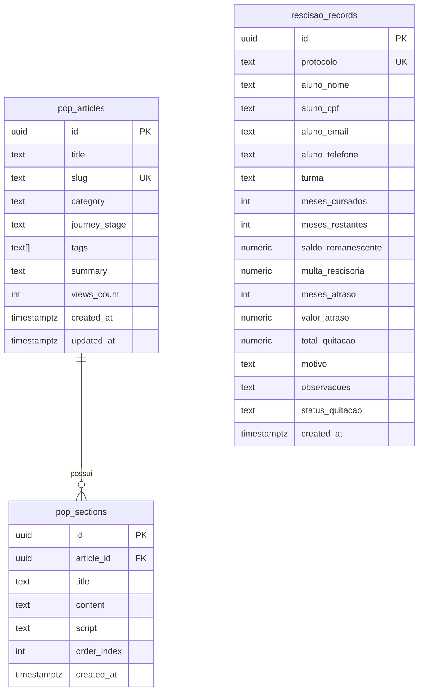

# Portal de Customer Success & Operações — MBA Executivo (Versão 2.0 | 2026)

Plataforma corporativa full-stack de **Customer Success (CS)**, **Base de Conhecimento POP**, **Guia de Saúde & Régua de Inatividade** e **Calculadora de Rescisão Contratual com Emissão de Termo Formal**, desenvolvida sob medida para as equipes de CS e Atendimento Acadêmico do **MBA Executivo em Gestão Estratégica, Liderança e Negócios**.

---

## 📌 1. Visão Geral do Produto & Objetivos de CS

### 1.1 O Programa MBA Executivo
O **MBA Executivo em Gestão Estratégica, Liderança e Negócios** é um programa de pós-graduação *lato sensu* voltado para C-Levels, diretores, gerentes e líderes seniores. 
- **Duração do Contrato:** 12 meses contínuos.
- **Modelo Financeiro:** Recorrência de 12 parcelas mensais de **R$ 500,00**, totalizando um valor contratado de **R$ 6.000,00**.
- **Carga Horária:** 360 horas com certificação digital homologada e chancelada via ICP-Brasil em conformidade com as diretrizes do MEC.

### 1.2 Objetivos Estratégicos e Metas de Customer Success
A operação de CS é focada no sucesso pedagógico, retenção contínua e garantia de percepção de valor executivo (ROI):
* **Aceleração do Time-to-Value (TTV):** Conduzir o executivo ao seu primeiro marco de valor prático em até **14 dias** corridos após a matrícula.
* **Índice de Engajamento Alvo (> 75%):** Garantir frequência mínima de 75% nas masterclasses síncronas, rodadas de networking e consumo de módulos no Ambiente Virtual de Aprendizagem (AVA).
* **Mitigação e Redução Ativa de Churn:** Atuação preventiva com base no Health Score e réguas de inatividade, limitando a evasão voluntária e ofertando contenção consultiva antes de qualquer cancelamento definitivo.
* **Net Promoter Score (NPS) Executivo (> 70):** Cultura de advocacy com engajamento de alunos promotores no Clube de Alumni e parcerias corporativas.

---

## 🗺️ 2. Mapeamento dos 3 Estágios da Jornada do Aluno

A jornada do estudante executivo foi desenhada com ritos operacionais padronizados, espelhados nos registros de `pop_articles` e `pop_sections` do Supabase:



### 🎯 Estágio 1: Boas-vindas & Onboarding (Dias 1 a 14)
* **Objetivo:** Estabelecer a relação de confiança executiva e assegurar o primeiro valor percebido (*Time-to-Value*).
* **Dias 1 a 3 (Ativação e Welcome Call):**
  - Geração imediata de credenciais no AVA e acesso prioritário à Biblioteca Digital de Casos de Negócios (Harvard/Pearson).
  - Primeiro contato do CSM dedicado via WhatsApp e e-mail corporativo em até **24 horas úteis**.
  - Realização da *Welcome Call* individual (15 minutos) para calibração de expectativas.
* **Dias 4 a 7 (Diagnóstico e Aula Magna):**
  - Aplicação do *Formulário Diagnóstico de Perfil Executivo* (cargo, desafios corporativos imediatos e aspirações). Alunos sem preenchimento até o 7º dia recebem contato ativo obrigatório.
  - Agendamento da Sessão Inaugural / Live Magna com a Coordenação Acadêmica e painel de liderança.
* **Dias 8 a 14 (Marco de Entrega - Módulo Zero):**
  - Conclusão do Módulo Zero (Metodologia de Estudo de Casos e Ferramentas).
  - Atribuição do selo *Onboarding Concluído* no CRM de CS. Alunos sem acesso no 10º dia entram na régua de inatividade.

### 📈 Estágio 2: Adoção & Engajamento Contínuo (Meses 2 a 10)
* **Objetivo:** Sustentar o ritmo acadêmico, fomentar networking de alto nível e evitar estafa profissional.
* **Cadência Quinzenal de Consumo & Masterclasses:**
  - Checagem quinzenal do progresso acadêmico. Presença síncrona mínima de 75% e consumo das videoaulas assíncronas.
  - Workshops mensais de *Networking Executivo* (alunos participantes possuem Health Score 35% superior).
* **Checkpoints Bimestrais de ROI (Meses 2, 4, 6 e 8):**
  - Reuniões individuais de 15 a 20 minutos com o CSM para avaliar a aplicação prática das ferramentas do MBA no dia a dia corporativo do executivo.
* **Protocolo Anti-Burnout / Sobrecarga de Trabalho:**
  - Durante picos corporativos (viagens de negócios, fechamentos de trimestre/quarter, fusões), o CSM aciona o **Plano de Estudo Flexível**, prorrogando entregas de projetos em até 15 dias sem penalidade pedagógica.

### 🎓 Estágio 3: Conclusão, Formação & Advocacy (Meses 11 e 12)
* **Objetivo:** Homologação do Projeto Aplicado, certificação oficial e perenização do relacionamento via Alumni.
* **Mês 11 (Projeto Final Aplicado / TCC Executivo):**
  - Orientação individual com docente executivo para estruturação do Business Case Final.
  - Auditoria documental completa (diploma de graduação autenticado, documento com foto e histórico escolar).
* **Mês 12 (Banca, Titulação e Registro MEC):**
  - Apresentação e homologação da nota pela banca avaliadora.
  - Expedição da certificação digital oficial lato sensu (MEC / ICP-Brasil) em até 30 dias úteis.
* **Advocacy & Clube de Alumni:**
  - Aplicação do NPS Final de Curso.
  - Para alunos Promotores (NPS 9-10): convite para gravação de videocase profissional, publicação no LinkedIn institucional e adesão ao conselho consultivo do Clube de Alumni com programa de indicação *Member-Get-Member*.

---

## 📊 3. Matriz de Health Score & Régua de Inatividade

### 3.1 Níveis de Saúde do Aluno Executivo

| Nível / Faixa Score | Indicadores & Critérios de Diagnóstico | Ações Automatizadas do Sistema | Intervenções Diretas do CSM |
| :--- | :--- | :--- | :--- |
| 🟢 **Verde (Saudável)**<br>`80 a 100 pontos` | • Acessos frequentes (≥ 3x/semana)<br>• 100% dos projetos em dia<br>• Presença confirmada em masterclasses<br>• NPS Promotor (9 ou 10)<br>• Mensalidades rigorosamente em dia | • E-mail de congratulação por módulo<br>• Badge de *Liderança Executiva* no AVA<br>• Convites automáticos para webinars com CEOs | • Contato bimestral de apuração de ROI<br>• Convite para painelista ou mentor convidado<br>• Apresentação do programa de Advocacy e indicação |
| 🟡 **Amarelo (Atenção)**<br>`50 a 79 pontos` | • Inatividade de **10 a 18 dias** no AVA<br>• 1 projeto prático em atraso (até 15d)<br>• Falta em encontro síncrono recente<br>• Feedback de dificuldade de tempo<br>• Atraso pontual de mensalidade (< 15d) | • E-mail amigável com resumo do módulo<br>• Envio de link WhatsApp de gravações 1-clique<br>• Alerta moderado no dashboard de CS | • Contato ativo em até **24h úteis**<br>• Sondagem de sobrecarga profissional<br>• Concessão de prorrogação assistida sem penalidade<br>• Elaboração de cronograma compacto de recuperação |
| 🔴 **Vermelho (Risco Alto)**<br>`0 a 49 pontos` | • Inatividade **> 20 dias consecutivos**<br>• 2 ou mais projetos pendentes<br>• Pedido informal de cancelamento<br>• Sem resposta a contatos há > 5 dias<br>• Inadimplência financeira > 30 dias | • Abertura de ticket crítico com **SLA de 4h**<br>• Bloqueio de e-mails de marketing/gerais<br>• Notificação push ao Coordenador de CS | • Ligação mandatória do CSM Sênior ou Coordenação<br>• **Aplicação imediata de contenção:** Trancamento de 60d ou Repactuação de Turma<br>• Proposta de acordo financeiro sem juros<br>• Se recusa total: transição assistida para a Calculadora |

### 3.2 Régua Operacional de Inatividade

* **Gatilho de 10 Dias de Inatividade (Nível Alerta):**
  - **Automação:** Disparo de e-mail transacional inteligente (*"Sentimos sua falta nas discussões executivas"*), envio de pílulas de conteúdo e link direto no WhatsApp com opção de suporte.
  - **Ação Humana:** O CSM monitora a leitura em até 24h. Em caso de permanência da inatividade, envia mensagem personalizada oferecendo apoio pedagógico e flexibilização de prazos.
* **Gatilho de 20 Dias de Inatividade (Nível Crítico):**
  - **Automação:** Alarme prioritário na central de CS, suspensão de comunicações impessoais e abertura de protocolo de evasão iminente.
  - **Ação Humana OBRIGATÓRIA:** Contato telefônico direto do CSM no prazo máximo de **48 horas corridas**, com oferta formal do **Trancamento Estratégico de até 60 dias sem custos** ou transferência para a turma subsequente. Se não houver retorno, escalona-se formalmente para a Coordenação Acadêmica.

---

## 🛑 4. Procedimento Operacional Padrão (POP) — Cancelamento & Rescisão

### 4.1 Abordagem Consultiva Prévia (Rito Mandatório de Contenção)
> [!IMPORTANT]
> **Diretriz Mandatória de Operações:** É expressamente proibido ao analista ou CSM deferir o cancelamento da matrícula ou emitir o termo rescisório sem antes aplicar as etapas obrigatórias de escuta ativa e as alternativas de contenção prévia.

Ao receber qualquer solicitação de encerramento contratual:
1. **Contato em até 4 horas úteis:** Realizar escuta ativa empática para mapear a causa-raiz (sobrecarga profissional, contingência financeira passageira ou desalinhamento pedagógico).
2. **Alternativa A — Trancamento Estratégico de Matrícula (até 60 dias):**
   - Pausa formal da matrícula por 30 a 60 dias.
   - Suspensão imediata da cobrança de mensalidades futuras.
   - **Isenção total** de taxas, juros ou encargos rescisórios.
   - Preservação integral dos créditos e notas das disciplinas já cursadas.
   - Retomada programada na turma subsequente.
3. **Alternativa B — Repactuação de Cronograma & Flexibilização:**
   - Dilação assistida de até 30 dias nos prazos de entrega de projetos.
   - Acesso integral às gravações assíncronas e participação como ouvinte nas aulas ao vivo da turma seguinte.
4. **Rescisão Inevitável:**
   - Somente após recusa expressa do aluno a ambas as opções de contenção, o analista deve acessar a tela `/calculadora-cancelamento`.

### 4.2 Parâmetros Contratuais & Memória de Cálculo da Multa Rescisória

Em total conformidade com o Contrato de Prestação de Serviços Educacionais e com o Artigo 9º do Decreto 22.626/33 (Lei de Usura) e Código de Defesa do Consumidor:
* **Duração Total do Contrato:** 12 meses
* **Valor da Parcela Mensal:** R$ 500,00
* **Valor Total do Contrato:** R$ 6.000,00
* **Alíquota de Multa Rescisória:** **20% (vinte por cento)** incidente estritamente sobre o **saldo remanescente das mensalidades dos meses não cursados**.

$$\text{Saldo Remanescente} = \text{Meses Restantes Não Cursados} \times \text{R\$} 500{,}00$$

$$\text{Multa Rescisória} = \text{Saldo Remanescente} \times 20\%$$

$$\text{Total para Quitação} = \text{Multa Rescisória} + \text{Mensalidades Cursadas em Atraso}$$

#### Exemplo Prático Oficial (Caso de Estudo do Edital)
* **Aluno com 1 mês cursado e adimplente:**
  * Meses cursados: 1 mês
  * Meses restantes: $12 - 1 = 11$ meses
  * Saldo remanescente: $11 \times \text{R\$} 500{,}00 = \text{R\$} 5.500{,}00$
  * Multa rescisória (20%): $20\% \times \text{R\$} 5.500{,}00 =$ **R$ 1.100,00**
  * Mensalidades em atraso: R$ 0,00
  * **Valor total para quitação rescisória:** **R$ 1.100,00**

---

### 4.3 Minuta Oficial do Termo Formal de Cancelamento

O sistema gera automaticamente o documento padronizado pronto para impressão (`@media print`), exportação em PDF e envio formal:

```text
================================================================================
TERMO FORMAL DE RESCISÃO CONTRATUAL E DEMONSTRATIVO FINANCEIRO
PORTAL DE CUSTOMER SUCCESS & OPERAÇÕES — MBA EXECUTIVO (2026)
================================================================================
Protocolo Oficial: REC-2026-XXXXXX
Data de Emissão: DD/MM/AAAA

DADOS DO CONTRATANTE:
Nome do(a) Aluno(a): [Nome Completo do Executivo]
CPF: [000.000.000-00]
E-mail: [aluno@dominio.com.br]
Telefone/WhatsApp: [(XX) 9XXXX-XXXX]
Curso / Turma: MBA Executivo em Gestão Estratégica, Liderança e Negócios
Motivo Declarado: [Motivo declarado pelo aluno]

PARÂMETROS CONTRATUAIS DO MBA EXECUTIVO:
- Duração Total do Contrato: 12 meses
- Valor da Mensalidade Contratada: R$ 500,00
- Valor Total do Curso Contratado: R$ 6.000,00
- Regra Contratual de Multa: 20% (vinte por cento) sobre o saldo remanescente 
  das mensalidades referentes aos meses não cursados.

MEMÓRIA DE CÁLCULO RESCISÓRIO:
1. Meses Efetivamente Cursados: [X] mês(es)
2. Meses Remanescentes Não Cursados: [Y] mês(es)
3. Saldo Remanescente dos Meses Não Cursados: [Y] x R$ 500,00 = R$ [Saldo]
4. Multa Rescisória Contratual (20% sobre saldo remanescente): R$ [Multa]
5. Mensalidades Cursadas em Aberto: [Z parcelas] = R$ [Valor Atraso]
--------------------------------------------------------------------------------
VALOR TOTAL LÍQUIDO PARA QUITAÇÃO RESCISÓRIA: R$ [Total]
--------------------------------------------------------------------------------

FORMAS DE PAGAMENTO AUTORIZADAS:
- OPÇÃO 1: PIX Instantâneo
  Chave PIX (CNPJ Oficial): 12.345.678/0001-99
  Identificador / Descrição: MBA-REC-2026-XXXXXX
  Compensação: Imediata

- OPÇÃO 2: Cartão de Crédito
  Parcelamento em até 6x sem juros de R$ [Total / 6]
  Link Seguro: https://pagamentos.mbaexecutivo.edu.br/checkout/REC-2026-XXXXXX

- OPÇÃO 3: Boleto Bancário
  Linha Digitável: 23793.38128 60000.123456 78000.123456 1 98760000XXXX
  Vencimento: 3 (três) dias úteis a contar desta emissão.

PRÓXIMOS PASSOS OPERACIONAIS:
1. Efetuar o pagamento da quitação rescisória por uma das opções acima até o vencimento.
2. Encaminhar o comprovante de pagamento ao CSM via WhatsApp ou respondendo a este e-mail.
3. A Secretaria Acadêmica emitirá a Certidão de Desligamento e o Histórico Escolar 
   Parcial das disciplinas cursadas no prazo de até 5 (cinco) dias úteis.
4. Os créditos das disciplinas concluídas com aproveitamento permanecem válidos por 
   até 2 (dois) anos para eventual reaproveitamento futuro.

Observações da Operação: [Contenção de 60 dias recusada formalmente pelo aluno].

Atenciosamente,
Gerência de Customer Success & Operações Acadêmicas
MBA Executivo — Versão 2.0 (2026)
```

#### Modelo de Comunicação Rápida (WhatsApp do CSM):
```text
Olá, *[Nome do Aluno]*! Aqui é do *Customer Success do MBA Executivo*.

Conforme alinhamos a respeito da sua solicitação de encerramento de matrícula, formalizamos o demonstrativo financeiro rescisório sob o protocolo *#REC-2026-XXXXXX*:

📊 *Resumo Contratual:*
• Meses Cursados: [X] de 12 meses
• Meses Restantes: [Y] meses (Saldo: R$ [Saldo])
• *Multa Rescisória (20% sobre saldo não cursado):* *R$ [Multa]*
💰 *Total para Quitação Rescisória:* *R$ [Total]*

💳 *Opções de Pagamento:*
1️⃣ *PIX:* Chave CNPJ: `12.345.678/0001-99` (Identificador: REC-2026-XXXXXX)
2️⃣ *Cartão:* Em até 6x sem juros no link: https://pagamentos.mbaexecutivo.edu.br/checkout/REC-2026-XXXXXX
3️⃣ *Boleto:* Linha digitável com vencimento em 3 dias úteis.

Após o envio do comprovante, sua Certidão de Desligamento e Histórico Parcial serão emitidos em até 5 dias úteis. Permanecemos sempre à disposição caso deseje retomar no futuro!
```

---

## 🛠️ 5. Arquitetura Técnica, Banco de Dados & Scripts

### 5.1 Stack Tecnológico
- **Frontend & SSR:** TanStack Start v1 (`@tanstack/react-start`) com `@tanstack/react-router`.
- **Compilador & Bundler:** Vite 8 com React 19 e Rolldown.
- **Estilização & Design System:** Tailwind CSS v4 nativo (`@theme`), Radix UI / shadcn tokens e ícones Lucide React.
- **Backend & Database:** Supabase PostgreSQL com Row Level Security (RLS) habilitada.
- **Serverless Runtime:** Node.js Serverless Function em `api/index.js` otimizada para deploy na Vercel com fallback de hidratação estática.

### 5.2 Modelo Entidade-Relacionamento (PostgreSQL)



* **`schema.sql`:** DDL com criação das tabelas `pop_articles`, `pop_sections` e `rescisao_records`, políticas de RLS para usuários autenticados e índices GIN/B-Tree de performance.
* **`scripts/seed.mjs`:** Sincronização e carga de dados de onboarding, jornada de adoção, conclusão e procedimento de cancelamento via API REST PostgREST.

---

## 💻 6. Guia de Instalação, Execução & Deploy

### 6.1 Pré-requisitos
* **Node.js:** Versão 20.x ou 22.x LTS
* **npm:** Versão 10.x ou superior

### 6.2 Instalação e Execução Local
```bash
# 1. Clonar o repositório
git clone https://github.com/gabrielfranca0901/portal-cs-mba-executivo.git
cd portal-cs-mba-executivo

# 2. Instalar dependências respeitando a diretriz de peer deps
npm install --legacy-peer-deps

# 3. Configurar variáveis de ambiente em .env
cp .env.example .env
# Preencha VITE_SUPABASE_URL e VITE_SUPABASE_ANON_KEY

# 4. Executar sincronização de rotas e servidor local
npm run dev
# Acesse em: http://localhost:5173
```

### 6.3 Build e Deploy na Vercel
O projeto conta com o `vercel.json` preparado para compilação full-stack:
```json
{
  "$schema": "https://openapi.vercel.sh/vercel.json",
  "installCommand": "npm install --legacy-peer-deps",
  "buildCommand": "npm run build",
  "outputDirectory": "dist/client",
  "functions": {
    "api/index.js": {
      "includeFiles": "dist/**"
    }
  },
  "rewrites": [
    { "source": "/assets/(.*)", "destination": "/assets/$1" },
    { "source": "/(.*)", "destination": "/api/index.js" }
  ]
}
```

Comando de build executado em produção:
```bash
npm run build
# 1. node scripts/generate-routes.js (Gera rotas tipadas do TanStack Router)
# 2. vite build (Compila bundles de cliente e SSR em dist/client e dist/server)
# 3. node scripts/post-build.js (Gera dist/client/index.html fallback)
```

---

## 🔒 7. Políticas de Segurança e RLS
* **Row Level Security (RLS):** Ativa em todas as tabelas com permissão de leitura restrita a usuários logados (`authenticated`).
* **Autenticação:** Supabase Auth (e-mail e senha) com checagem de sessão em `beforeLoad` nas rotas do TanStack Router.
* **Proteção de Dados (LGPD):** Dados sensíveis de contratos e termos rescisórios são emitidos com mascaramento parcial e salvos sob protocolo auditável.
